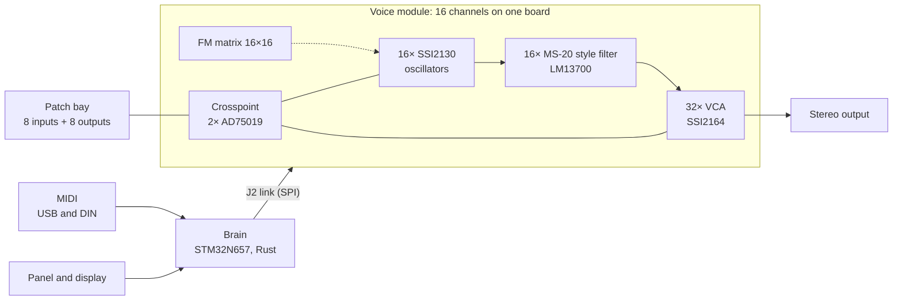

<p align="center">
  
</p>

<h1 align="center">SAM17</h1>

<p align="center"><strong>A 16-voice analog synthesizer that patches like a modular and recalls like a polysynth.</strong></p>

<p align="center">
  16 complete analog voices &nbsp;·&nbsp; FM matrix 16×16 &nbsp;·&nbsp; 8-in/8-out patch bay &nbsp;·&nbsp; STM32N657 brain running Rust &nbsp;·&nbsp; three rows on Eurorack rails<br>
  hardware CERN-OHL-S v2 &nbsp;·&nbsp; firmware GPL-3.0-or-later &nbsp;·&nbsp; documentation CC BY-SA 4.0
</p>

<p align="center">
  <a href="docs/superpowers/specs">Specs</a> &nbsp;·&nbsp;
  <a href="hardware">Hardware</a> &nbsp;·&nbsp;
  <a href="software/nucleo">Firmware</a> &nbsp;·&nbsp;
  <a href="case">Case</a> &nbsp;·&nbsp;
  <a href="https://github.com/sssamuelll/sam17/milestones">Milestones</a>
</p>

> [!IMPORTANT]
> **There is no finished unit yet.** The render above is the console as it
> stands in the OpenSCAD model in [`case/`](case); nothing in it exists yet.
> What exists physically today, of this design, is the STM32N657 evaluation
> board on the bench, with the firmware running on it. The voice board is
> specified but not yet drawn. The power supply board is routed and its parts
> are signed, but it is not yet cleared for fabrication. The first complete
> instrument is due in May 2027. Details, with dates, under
> [Status](#status-october-2026).

It began as Samuel Ballesteros's electronic engineering thesis at Universidad
Yacambú, Venezuela, in 2020, a monophonic modular in seven modules. In 2022 the
Goethe-Institut Venezuela selected it for its programme *Pensar la Música
Electrónica en Venezuela*. Since then it has been redesigned, in Germany, as
the sixteen-voice instrument this repository describes.

The working language of the project is Spanish: specs, budgets and design
notes are written in Spanish. This README is in English because it is the
front door.

## The instrument



*Inside the instrument the patch is a preset; outside, it is a cable.*

- Sixteen complete voices, each one oscillator → filter → VCA soldered end to
  end on the same board. The copper builds channels; **the preset assigns the
  roles**: sixteen clean voices, eight FM voices with carrier and modulator, or
  any mix.
- Sixteen rather than eight because in FM each voice needs two oscillators:
  the modulator has to track its carrier in frequency. One modulator shared by
  eight different notes gives dissonant bells.
- The oscillators are SSI2130, with saw, triangle, pulse, and sine from the
  chip's shaper. A 16-line FM matrix lets any oscillator modulate any other,
  which is why all sixteen sit in one module. Split in two, the matrix splits
  with them.
- One filter per voice, a 24 dB/oct MS-20 style low-pass on an LM13700 and a
  TL074. The resonance is controlled by a VCA, never by a digipot.
- Two VCAs per voice, signal and resonance. Thirty-two in all, on eight
  SSI2164.
- The envelopes run as code on the voice module's microcontroller, with their
  own knobs on the panel. There is no envelope circuit.
- The patch bay has eight inputs and eight outputs, with jack sensing and an
  LED per jack, routed through two AD75019, a 16×16 crosspoint. The brain sends
  the crosspoint image over the J2 link.
- The brain is an STM32N657 running bare-metal Rust
  ([`software/nucleo`](software/nucleo)). It takes MIDI over USB and DIN,
  drives the panel and the display, and talks to the voice module over the J2,
  an SPI link with its header, master and recovery already specified.
- The output is stereo, with a place for each voice in the stereo field.
- The console has three rows on 104 HP Eurorack rails. The instrument's
  unified panel is on top, 3U. A slim 55 mm utility row in the middle takes the
  instrument's connection tiles; it is not Intellijel 1U and is not advertised
  as compatible. A 3U Eurorack row below is for the instrument's own expansion
  modules, with its own current budget. The skeleton is machined aluminium.
  Each side is a louvre of black anodised aluminium, 44 vertical bars the
  instrument breathes through; the rear panel is amber, and the case stands
  on a 3 mm sheet-metal base. Dimensions, materials and drawings in
  [`case/README.md`](case/README.md).
- Power is 230 VAC through an external 24 V brick, an SL Power TE90 that
  plugs into a 4-pin mini-DIN socket on the case. In the v5 supply, signed
  on 8 September 2026 ([spec](docs/superpowers/specs/2026-09-05-fuente-v5-ladrillo-design.md)),
  the AC-DC stage moves out of the case. Inside it stay five isolated DC-DC
  modules and the cascade of linear regulators carried over from v4, behind a
  protection chain against reverse polarity, overvoltage and overload. The v5
  board is routed on four layers with a clean DRC
  ([`hardware/01-power-supply/v5/fab`](hardware/01-power-supply/v5/fab)), and
  its [parts](docs/superpowers/specs/2026-10-22-fuente-v5-piezas-propuesta.md)
  were reviewed on 25 October and signed on 26 and 27 October
  ([review](docs/superpowers/specs/2026-10-25-junta-fuente-v5-piezas.md)). It
  is not cleared for copper yet: the open questions in §9.2 of the spec, 13 of
  the original 16 after Advanced Energy's first reply on 28 October, are the
  condition for fabrication, several of them answered only by the
  manufacturers. Ten hold up the board, and three only the rear panel, the
  chassis and the display. Tests that need the built board run in its
  bring-up. The test kit runs from a bench supply.

<p align="center">
  
</p>

*At night, with a light inside for the render. Each side is a louvre of 44
bars, and it is where the instrument breathes.*

## Status, October 2026

The project map is the
[GitHub milestones](https://github.com/sssamuelll/sam17/milestones):
eight stages, each with its "done when" in the description, and every issue
hangs from one of them. As of 30 October 2026:

| Milestone | Done when | Where it stands |
|---|---|---|
| 1 · Power supply v4: paper closed | No open decision is left in the power supply paper | The supply that gets built is now v5, signed on 8 September. Its parts were signed on 26 and 27 October and the board regenerated with them; its gates and DRC pass. Advanced Energy answered the first round of questions on 28 October (closing `H-V2-AISLAMIENTO`); between the board and copper stand 10 open questions of §9.2 (plus 3 outside the board), the follow-ups with Advanced Energy and TRACO Power, and three open issues. The bench tests come after, on the first board |
| 2 · Power supply v4 in copper | The supply boards are built and measured on the bench | Not started. The v5 bring-up is written as a checked sheet of 108 measurements with their limits ([`check_bringup.py`](hardware/01-power-supply/v5/check_bringup.py)) |
| 3 · The brain boots | Our firmware runs on the N657, speaks USB MIDI and lights the display | In progress: the firmware has run on the NUCLEO-N657X0-Q since 1 October. It takes USB MIDI, measured at 5,000 messages per second on 19 October, and drives the J2 link from an 8 kHz tick. After a 24-hour run at 1 kHz on 17 October, the 8 kHz soak from a Raspberry Pi finished 144 hours on 27 October (4,147,199,999 transfers with zero missed deadlines, zero late EOTs and zero bad edges, covering the 8-hour horizon) |
| 4 · Test kit: brain plus one voice | A MIDI note comes in and one voice sounds through the J2 | The current front: the J2 header and master are on paper and in the firmware, which since 20 October also carries the voice module's v1 message set. The full voice board has no KiCad in the repository yet |
| 5 · The remaining boards | The rest of the boards are in KiCad with their gates green | Pending |
| 6 · Case and panel to the workshop | Case and panel cut and assembled, with the supply inside and breathing | Skeleton drawings in [`case/plans`](case/plans). The finish was decided on 11 and 12 October: louvred sides, amber rear, sheet-metal base. Next come a sample strip of the louvre and a bench test of the 24 V socket before its floor bracket goes out for quotes ([`case/RFQ.md`](case/RFQ.md)) |
| 7 · The first SAM17 that sounds | Everything in the case, calibrated, thirty minutes without drifting | Depends on all of the above |
| 8 · Parked: does not block sound | App and plugin, sequencer, the agent | Resumes after 7 |

What exists physically today, of this design, is the N657 evaluation board on
the bench.

## Where it comes from

- [`docs/thesis.pdf`](docs/thesis.pdf): the 2020 thesis, in Spanish. Seven
  monophonic modules with three CEM3340, an MS-20 style filter, and MIDI/CV
  control from a Raspberry Pi and an AD5686R DAC. Summary in
  [`docs/summary.md`](docs/summary.md), monophonic architecture in
  [`docs/architecture.md`](docs/architecture.md).
- The v1 firmware, Python on a Raspberry Pi, stays in
  [`software/midi-cv`](software/midi-cv) for reference. It is superseded.
- The thesis numbering of seven modules survives as the folder index in
  [`hardware/`](hardware), although the current design is no longer seven
  boards: the voice module absorbed four of them, for the reason given in §1
  of the [voice module spec](docs/superpowers/specs/2026-08-23-modulo-voz-total-design.md).

## Repository map

```
sam17/
├── docs/
│   ├── superpowers/specs/   The current design: dated specs, the newest one rules.
│   ├── superpowers/plans/   Work plans, one per spec.
│   ├── modules/             Documentation per thesis module.
│   ├── reference/           Datasheets and references.
│   ├── thesis.pdf           The 2020 thesis; its summary in summary.md.
│   └── architecture*.md     Monophonic (thesis), polyphonic and compute architecture.
├── hardware/
│   ├── 01-power-supply/     Power supply: v1 to v5, bring-up and budgets; v5 is the one built.
│   ├── 02-midi-cv/          The brain: the N657 board and the J2 budgets.
│   ├── 03-vco/              The voice: 16 channels, FM matrix and patch bay (its 4-VCO v1, superseded).
│   ├── 04..07/              Mixer, VCF, ADSR and VCA from the thesis, dissolved into the voice.
│   ├── bus-board/           ±12 V distribution and the ground budget.
│   └── tools/               gates.py and the check_* and *_budget scripts that are the quality gates.
├── software/
│   ├── nucleo/              Rust firmware for the STM32N657.
│   └── midi-cv/             Python firmware of v1, superseded.
├── simulations/             SPICE per block: vco, vcf, vca, adsr, mixer, power.
├── case/                    The console: cad/ (OpenSCAD), plans/ (DXF), panels/, renders/,
│                            clearance_budget.py and the workshop PLIEGO.
├── .specify/memory/         The project constitution.
└── .githooks/               The gates that run on every push.
```

## Getting started

1. **The current design lives in the dated specs** in
   [`docs/superpowers/specs/`](docs/superpowers/specs), and the newest one
   rules. The ones governing the instrument today:
   [the voice module](docs/superpowers/specs/2026-08-23-modulo-voz-total-design.md),
   [the brain v2](docs/superpowers/specs/2026-08-21-modulo-2-v2-cerebro-design.md),
   [the whole instrument](docs/superpowers/specs/2026-09-03-instrumento-entero-design.md),
   [the power supply v5](docs/superpowers/specs/2026-09-05-fuente-v5-ladrillo-design.md),
   and for the link between brain and voice the J2
   [header](docs/superpowers/specs/2026-09-02-cabecera-j2-design.md) and
   [master](docs/superpowers/specs/2026-09-03-maestro-j2-recuperacion-design.md).
   [`docs/architecture-poly.md`](docs/architecture-poly.md) is pending a
   rewrite against them and carries a notice.
2. **The hardware quality gates** run on the Python standard library, with no
   dependencies:

   ```bash
   python hardware/tools/gates.py
   ```

   It runs every `check_*.py`, every `*_budget.py`, the simulations and the
   connectivity signature. Details in
   [`hardware/tools/README.md`](hardware/tools/README.md).
3. **The firmware:**

   ```bash
   cd software/nucleo && cargo test --workspace
   ```

   The N657 binary links separately, in `software/nucleo/fw`.
4. **The console** is regenerated from [`case/`](case): its README explains
   the OpenSCAD, the DXF and the clearance budgets.
5. **To contribute**, read the [constitution](.specify/memory/constitution.md)
   and [`CONTRIBUTING.md`](CONTRIBUTING.md). Every issue carries a milestone.

## Licence and name

See [`LICENSE`](LICENSE). Hardware designs are licensed under CERN-OHL-S v2,
software under GPL-3.0-or-later, and documentation under CC BY-SA 4.0. The
original thesis is included for documentation only.

The name **SAM17** is not part of any of the licences: you may build, modify
and sell derivatives of this design under their terms, but you may not call
them SAM17 or present them as original or endorsed units. Descriptive use
("based on the SAM17 design") is fine.
